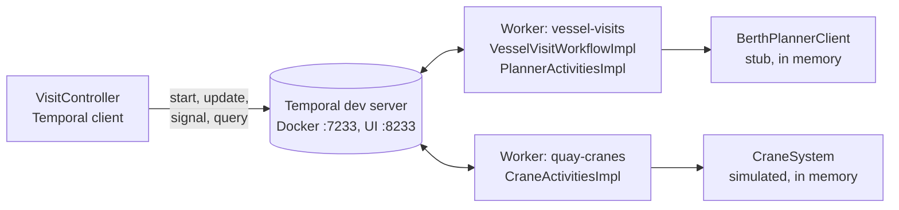

# Design and roadmap

## What it does

The berth planner ([ship-eta-berth-scheduler](https://github.com/Rohit-v-raj/ship-eta-berth-scheduler))
decides when and where a ship berths. This service runs what happens **after**
the berth is confirmed, as one Temporal workflow per visit:

1. **Berth confirmed** (`POST /api/visits`) starts workflow `visit-{imo}-{voyageNo}`.
2. **Move list** (`PUT .../move-list`, an *update*) is validated and accepted, or rejected.
   It must arrive within 24 terminal hours (a *durable timer*), or the visit fails.
3. **Ship alongside** (`POST .../berthed`, a *signal*).
4. **Cranes:** 1 to 3 reserved, bays split into contiguous ranges, every crane
   working at once (`Async`). Each bay is one *activity* that *heartbeats* after
   every move. Transient failures are *retried*. A breakdown is *non-retryable*,
   and its bays go to the neighbouring crane.
5. **ETC** recomputed after every bay from the cranes' real speed; if the ship will
   finish more than 60 minutes late, the planner is warned once.
6. **Completion:** cranes released, handling time reported, an hour for lashing
   (a *timer*), then the departure and the berth released.
7. **Progress** (`GET /api/visits/{id}`, a *query*) at any time, even after the end.

All time is on a **terminal clock** running 360 times faster than real time,
so a 12-hour visit takes about two minutes.

## Architecture

One Spring Boot process (:8081) holds the client, both workers and the simulated
systems. There is no database: a visit's state is its event history in Temporal.

## Decisions

| Topic | Decision |
|---|---|
| Build | Gradle wrapper 8.10.2, Java 21, Spring Boot 3.5.16 |
| Temporal | `temporal-spring-boot-starter` 1.40.0 with workers auto-discovery; `temporal-testing` for tests |
| Server | `temporalio/temporal:1.9.1` (`server start-dev`, server 1.32.0) in Docker Compose; history on a volume |
| Workflows | `@WorkflowImpl` only, never Spring beans; settings reach the workflow in its input (`VisitStart.settings`), never from configuration, so replay is deterministic |
| Activities | Spring `@Component` + `@ActivityImpl`; idempotent, because a retry may repeat one |
| Task queues | `vessel-visits` for the workflow and planner calls, `quay-cranes` for crane work, so crane work can move to other machines without touching the workflow |
| Planner | Every call goes through `BerthPlannerClient`; a stub today |

## How it uses Temporal

| Feature | Where |
|---|---|
| Workflow started from REST, workflow ID as business key, `USE_EXISTING` conflict policy | `api/VisitController.java` |
| Update with validator (move list) | `workflow/VesselVisitWorkflow.java`, `VesselVisitWorkflowImpl.validateMoveList` |
| Signal (berthed), query (progress), `@WorkflowInit` | `VesselVisitWorkflowImpl` |
| Durable timers, `Workflow.await` with a timeout | `VesselVisitWorkflowImpl.run` |
| Parallel crane loops with `Async.procedure` | `VesselVisitWorkflowImpl.startCrane` |
| Retry policy, start-to-close and heartbeat timeouts | activity options in `VesselVisitWorkflowImpl` |
| Heartbeats with resume from details | `activity/CraneActivitiesImpl.workBay` |
| Non-retryable failure with details (breakdown) | `CraneActivitiesImpl.workBay`, handled in `VesselVisitWorkflowImpl.workCrane` |
| Pure, deterministic logic inside the workflow | `workflow/CraneSplit.java`, `workflow/EtcCalculator.java`, `workflow/TerminalClock.java` |
| Time-skipping tests with fake activities | `src/test/java/com/port/ops/workflow/VesselVisitWorkflowTest.java` |

## Roadmap

**Connecting the berth planner**

- `HttpBerthPlannerClient` beside the stub (`ops.planner.mode=stub|http`), calling
  `port-scheduler-api` on :8080. A 4xx becomes a non-retryable failure; 5xx and
  timeouts are retried.
- The planner already offers `GET /api/visits/{ref}` and
  `PUT /api/port/berths/{code}/release`. It would need:
  - **A.** A terminal estimate in (`POST /api/visits/{ref}/estimates`): CARGO_OPS_COMPLETE
    and DEPARTURE_BERTH EST, the allocation's planned end moved, the queue replanned.
  - **B.** Cargo-operations actuals in (`POST /api/visits/{ref}/cargo-operations`): two
    ACT events.
  - **C.** *(optional)* Typical stay derived from actual handling times.
  - **D.** A notifier from the planner to this service, after commit: berth confirmed,
    window changed, ship arrived, call cancelled.
- The planner does not record voyage numbers, so the workflow ID would use its visit reference.
- A diagram in both READMEs showing how the two services talk.

**Workflow**

- **Child workflows:** one `CraneWorkflow` per crane, with its own history and queries.
- **A spare crane after a breakdown:** today the broken crane's bays go to a neighbour
  even when another crane is free. A validated update such as `reassignCrane` would
  let a supervisor bring the spare one in.
- **All cranes down:** today the visit fails; a real terminal would wait for a repair.
- **Saga and cancellation:** compensate crane, tractor and labour bookings when the
  visit is cancelled or moved, in a detached `CancellationScope`.
- **Planner moves the ship:** a `berthWindowChanged` signal that replans the visit.
- **Shift boundaries:** a timer per shift that books the next labour gangs.
- **Repeated overrun warnings:** warn again when the ETC drifts by another threshold.
- **Continue-as-new** for visits with many events.
- **Replay tests** from exported histories, and **versioning** with `Workflow.getVersion`.
- **Durable external systems:** crane reservations in a database, so a restarted
  worker finds them still held.
