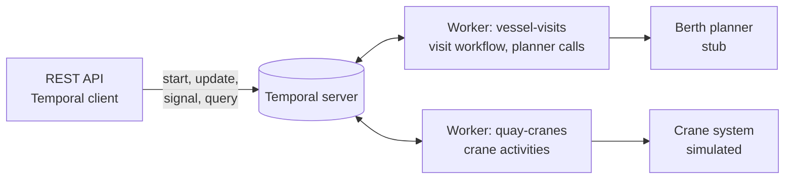

# Vessel Operations Orchestrator

Runs a vessel visit at the quay as a durable [Temporal](https://temporal.io)
workflow, from the berth being confirmed to the ship sailing.

The berth planner in
[ship-eta-berth-scheduler](https://github.com/Rohit-v-raj/ship-eta-berth-scheduler)
decides **when and where** a ship berths. This service takes over **after** that.

1. It waits for the shipping line's move list (validated, with a deadline).
2. It waits for the ship to be alongside.
3. It splits the bays across one to three quay cranes and works them in parallel.
4. While the cranes work, it recomputes the estimated completion and warns the
   planner when the ship will overrun its berth window, so the planner can slow
   the next ships down instead of having them wait at anchor.
5. At the end it reports the actual handling time and releases the berth.

Crane failures are retried, a crane that breaks down hands its remaining bays to
its neighbour, and a worker that crashes mid-bay resumes at the next container.
The cranes and the planner are simulated, and a terminal clock runs 360 times
faster than real time, so a 12-hour visit takes about two minutes.



## Quick start (Windows, cmd)

You need Java 21 and Docker Desktop (running). Gradle is not needed: `gradlew.bat`
downloads it on first use.

```cmd
docker compose up -d
gradlew.bat build
gradlew.bat bootRun
```

In a second window:

```cmd
cd demo
curl -s -X POST http://localhost:8081/api/visits -H "Content-Type: application/json" -d @berth-confirmed.json
curl -s -X PUT http://localhost:8081/api/visits/visit-9321483-V042/move-list -H "Content-Type: application/json" -d @move-list.json
curl -s -X POST http://localhost:8081/api/visits/visit-9321483-V042/berthed
curl -s http://localhost:8081/api/visits/visit-9321483-V042
```

Watch the visit in the Temporal Web UI at http://localhost:8233.

## API

| Call | Temporal | What it does |
|---|---|---|
| `POST /api/visits` | start workflow | Berth confirmed: starts `visit-{imo}-{voyageNo}`; sending it again returns the same visit |
| `PUT /api/visits/{id}/move-list` | update | Sends the move list; 400 with the reason if it is invalid |
| `POST /api/visits/{id}/berthed` | signal | The ship is alongside |
| `GET /api/visits/{id}` | query | Phase, moves per crane, ETC and DCSA-style timestamps (EST, PLN, ACT) |
| `GET /api/cranes` | | The simulated crane system: which visit holds which crane |
| `GET /api/planner/messages` | | What the stub berth planner was told |

Settings (time scale, crane rate, failure and breakdown rates, deadlines) are in
`src/main/resources/application.yml` and can be overridden, for example
`gradlew.bat bootRun --args="--ops.sim.breakdown-rate=0.1"`.

## Design and roadmap

[PLAN.md](PLAN.md): how the workflow is built, and what comes next, including
connecting the real berth planner.

## Stack

Java 21 · Spring Boot 3.5 · Temporal Java SDK 1.40 (`temporal-spring-boot-starter`) ·
Gradle · Temporal dev server 1.32 in Docker. No database: a visit's state lives
in Temporal.
